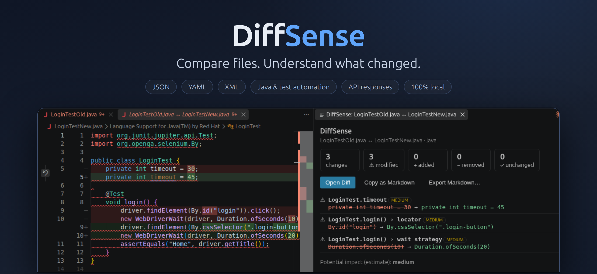

# DiffSense

[](https://marketplace.visualstudio.com/items?itemName=RazaTech.diffsense-vscode)



**Know which test changes will make your suite flaky, before you merge.**

A line diff shows that `By.id("login")` became `By.cssSelector(".login-button")` and that a wait went from 10 to 20 seconds. DiffSense tells you what that means: the locator changed, the wait strategy changed, the assertion did not, and the overall risk is medium.

```
LoginTest.login() › locator
  By.id("login") → By.cssSelector(".login-button")
  Impact: MEDIUM

LoginTest.login() › wait strategy
  Duration.ofSeconds(10) → Duration.ofSeconds(20)
  Impact: MEDIUM

Unchanged: LoginTest.login() › assertion
```

Try it in 30 seconds: `node packages/cli/dist/index.js compare samples/LoginTestOld.java samples/LoginTestNew.java`

### On a real repository

Run against the history of [bonigarcia/selenium-webdriver-java](https://github.com/bonigarcia/selenium-webdriver-java) (JUnit 4, JUnit 5 and TestNG copies of every test):

```
$ diffsense git 84eae4d^..84eae4d
⚠ 2 files with the same change  (1 added each)  [HIGH]
    + @Ignore: @Ignore("Broken in Chrome 142")  — Test disabled; it will no longer run. Reason given: "Broken in Chrome 142".
      · …/ch05/monitoring/RecordChromeJUnit4Test.java
      · …/ch05/monitoring/RecordChromeNGTest.java
⚠ 2 files with the same change  (1 added each)  [HIGH]
    + @Disabled: @Disabled("Broken in Chrome 142")  — Test disabled; it will no longer run. ...
```

A commit that bumps the Chrome DevTools protocol from v138 to v147 touches 41 test files. DiffSense reports it as three grouped entries, each led by a single "version bump v138 → v147" line, instead of 41 near-identical diffs. Add `--fail-on high` to fail a CI job when a test is disabled or an assertion is removed.

The same engine also explains config (JSON, YAML, XML), API response and EDIFACT changes by structure, so a reordered key is not a change and `timeout: 30000 → 45000` is reported as exactly that. Your editor's native diff is still used for the side-by-side view.

## Install

- **VS Code:** [DiffSense Semantic Compare on the Visual Studio Marketplace](https://marketplace.visualstudio.com/items?itemName=RazaTech.diffsense-vscode), or search for "DiffSense Semantic Compare" in the Extensions view.
- **IntelliJ IDEA and other JetBrains IDEs:** submitted to the JetBrains Marketplace and awaiting review. Until it is published you can install the zip from [`packages/intellij`](packages/intellij) (build it with `./gradlew buildPlugin`) through Settings | Plugins | Install Plugin from Disk.

See [docs/DiffSense_Product_Requirements.md](docs/DiffSense_Product_Requirements.md) for the product requirements.

## Contributing

DiffSense is open source (MIT) and contributions are welcome, from typo fixes to new file formats.

- Start with [CONTRIBUTING.md](CONTRIBUTING.md) and the [architecture guide](docs/ARCHITECTURE.md)
- Pick something from the [`good first issue`](https://github.com/shossain786/diff-sense/labels/good%20first%20issue) or [`help wanted`](https://github.com/shossain786/diff-sense/labels/help%20wanted) labels
- Be kind: see the [Code of Conduct](CODE_OF_CONDUCT.md). Security problems: [SECURITY.md](SECURITY.md)

Every comparison runs on your machine. No network calls, no telemetry, and that will not change.

## Layout
- `packages/core` — VS Code-independent comparison engine (pure functions)
- `packages/cli` — thin CLI over the core (`diffsense compare a b`, `diffsense api expected actual`, `diffsense dir a/ b/` for two folders, `diffsense format file` to reformat JSON/XML/YAML/EDIFACT, `diffsense git [range]` for a multi-file semantic summary of a commit, branch or working tree; add `--markdown` for PR text or `--fail-on high` for CI)
- `packages/vscode` — the VS Code extension
- `packages/intellij` — the IntelliJ plugin (Kotlin port of the engine; see its README)
- `conformance` — shared test cases that keep the TypeScript and Kotlin engines identical

## GitHub Action

Summarize what a pull request really changes, as a PR comment and a job summary, and optionally fail on high-impact changes. Everything runs on the runner; nothing is sent anywhere.

```yaml
on: pull_request
permissions: { contents: read, pull-requests: write }
jobs:
  diffsense:
    runs-on: ubuntu-latest
    steps:
      - uses: actions/checkout@v4
        with: { fetch-depth: 0 }   # needed to diff against the base
      - uses: shossain786/diff-sense@v0.2.0
        with:
          fail-on: high            # optional: informational | low | medium | high | critical
```

Inputs: `range` (default: PR base...head), `fail-on`, `comment` (default `true`), `config`. Pull requests from forks get a read-only token, so set `comment: 'false'` there and use the job summary.

## Develop
```
npm install
npm run build && npm run typecheck && npm test
```
Press F5 in VS Code to launch the extension in a development host.

## Package the extension
```
npm run build
npm run package -w diffsense-vscode      # produces a .vsix
```

## License
MIT
